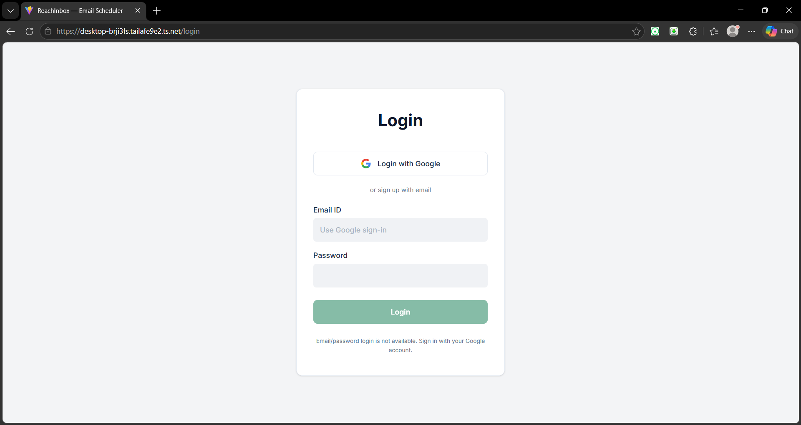
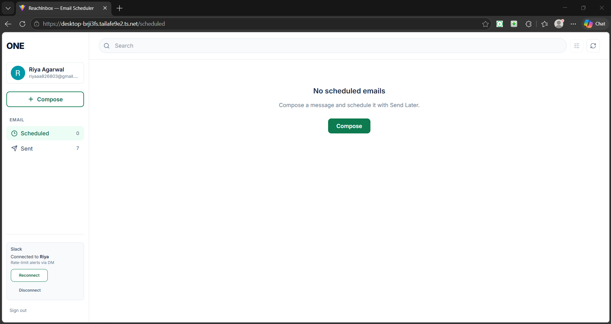
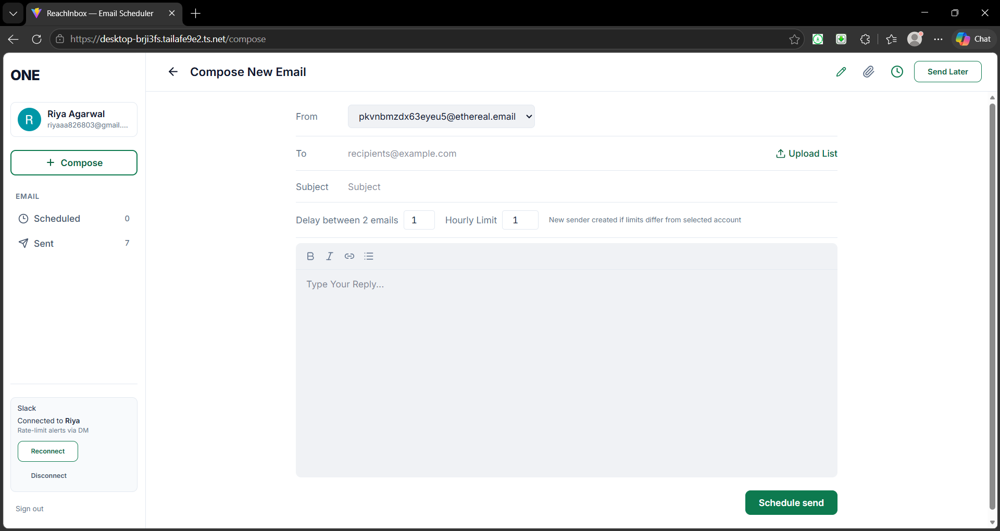
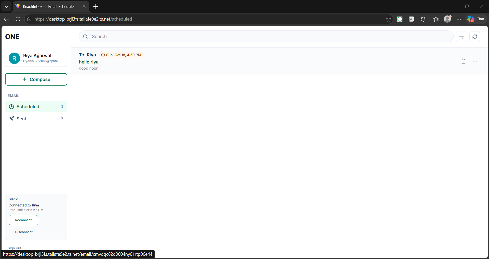
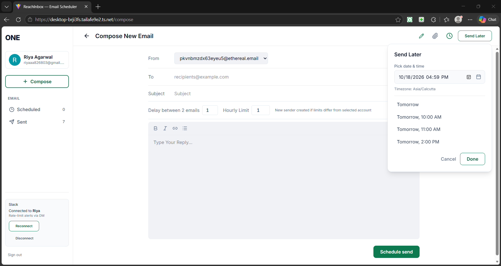
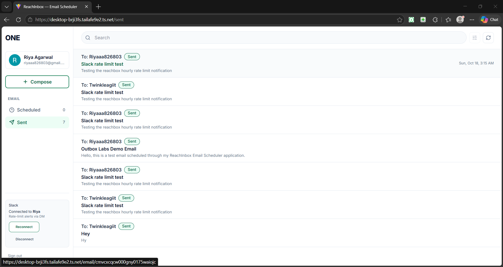
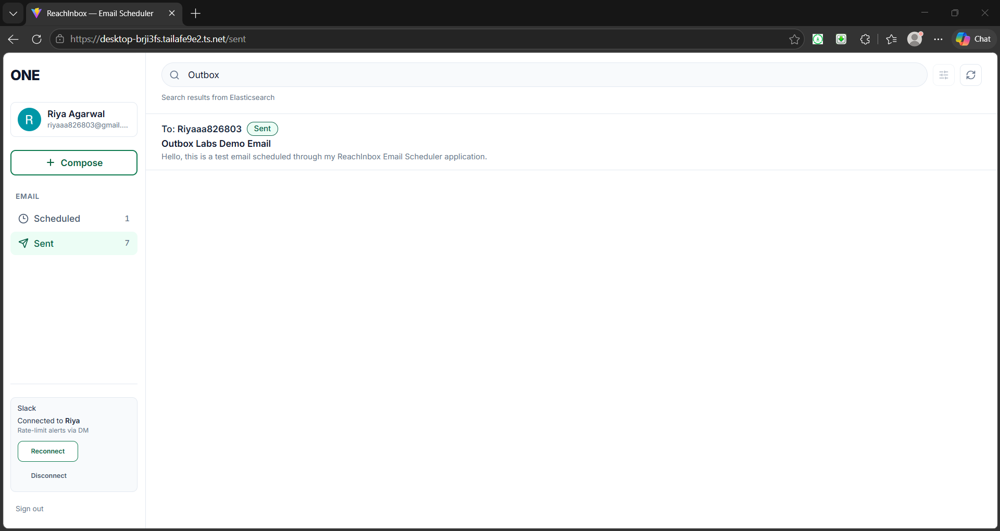
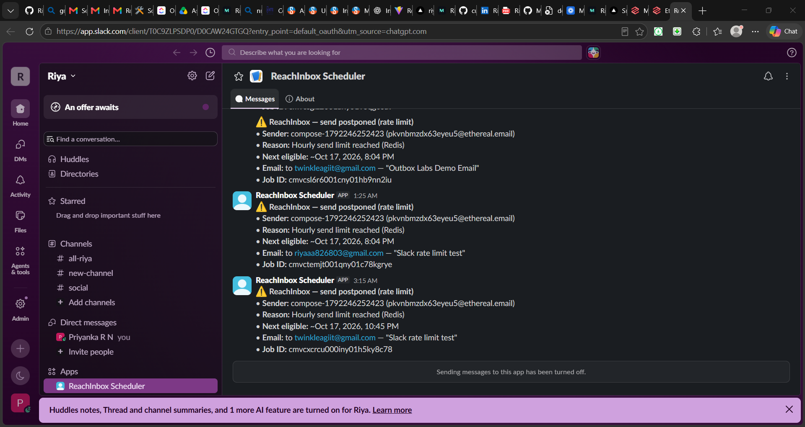
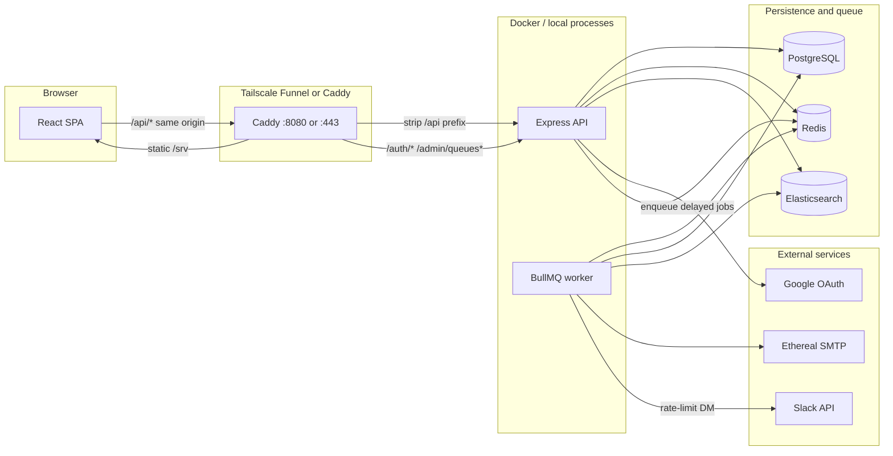

# ReachInbox Email Scheduler

A full-stack email scheduling application built for the **Outbox Labs Software Development Intern** take-home assignment. Users sign in with Google, compose and schedule outbound messages, and a background worker delivers them over SMTP (Ethereal in demo) with Redis-backed rate limits, Elasticsearch search, and optional Slack DM alerts when sends are postponed.

| | |
|---|---|
| **Live application** | https://desktop-brji3fs.tailafe9e2.ts.net |
| **GitHub** | https://github.com/Riya034/reachinbox-email-scheduler |
| **Demo video** | https://www.loom.com/share/c7d73862687940828923cb0201ef79f1 |

The live URL is served via **Tailscale Funnel** from a **Windows 11** laptop running **Docker Desktop**. Public HTTPS is available only while that machine, Docker, and Tailscale Funnel remain online. This is **not** 24/7 cloud hosting, a custom domain, or an SLA-backed deployment.

---

## Key features

- **Google OAuth** — session-based login with signed `httpOnly` cookies; per-user data isolation.
- **Schedule & send** — future `scheduledAt` timestamps; BullMQ delayed jobs (no cron).
- **Ethereal SMTP** — auto-provisioned test senders per user; encrypted credentials at rest.
- **Redis rate limits** — per-sender hourly cap and minimum delay; worker postpones jobs and retries.
- **Slack OAuth** — optional workspace connection; DM when a send is rate-limited (deduped).
- **Elasticsearch search** — subject/recipient search on Scheduled/Sent lists; Postgres is source of truth.
- **Operations** — Bull Board queue UI, health probes, startup reconciliation for pending jobs.
- **UI** — Figma-aligned React dashboard (compose, lists, detail, Slack card).

---


## Application screenshots

The screenshots below showcase the email scheduling workflow. Ethereal SMTP is used for testing; messages marked SENT are accepted by the test SMTP service, not delivered to real recipients' inboxes.

### 1. Google Sign-In



### 2. Main Dashboard



### 3. Compose and Schedule Email



### 4. Schedule Email



### 5. Send Later



### 6. Sent Emails



### 7. Elasticsearch Email Search



### 8. Slack Rate-Limit Notification



---


## Technology stack

| Layer | Technology |
|--------|------------|
| Monorepo | npm workspaces (`apps/api`, `apps/web`) |
| API | Node 20+, Express, TypeScript, Zod env validation |
| Web | React 19, Vite 6, TypeScript, Tailwind CSS 4 |
| Database | PostgreSQL 16, Prisma ORM |
| Queue | Redis 7, BullMQ 5 |
| Search | Elasticsearch 8.15 (single-node) |
| Mail | Nodemailer → Ethereal SMTP (`:587`) |
| Integrations | Google OAuth 2.0, Slack OAuth 2.0 (bot token, encrypted) |
| Local infra | `docker-compose.yml` (Postgres, Redis, ES) |
| Production / demo | `compose.prod.yml`, `compose.funnel.yml`, Caddy reverse proxy |
| CI | GitHub Actions (`.github/workflows/ci.yml`) — build + unit tests |

---

## System architecture



| Component | Role |
|-----------|------|
| **PostgreSQL** | Users, senders, campaigns, email rows, Slack connection metadata |
| **Redis** | BullMQ queue, API rate limiting, sender hourly/min-delay slots, OAuth state |
| **Elasticsearch** | `scheduled_emails` index for search (best-effort sync from API/worker) |
| **Express API** | Auth, REST, enqueue, indexing, Bull Board |
| **Worker** | Rate limit → SMTP send → status updates; Slack notify on postpone |
| **Caddy** | SPA hosting + reverse proxy (`/api` rewrite matches Vite dev proxy) |
| **Tailscale Funnel** | Public HTTPS termination → `http://127.0.0.1:8080` (funnel stack only) |

---

## Email scheduling and delivery workflow

1. Authenticated user `POST /emails` with recipient, subject, body, `scheduledAt`, optional `senderAccountId`.
2. Row created in Postgres (`SCHEDULED` → `QUEUED`); document indexed to Elasticsearch when possible.
3. BullMQ job added with **delay** until `scheduledAt` (job id tied to email id for idempotency).
4. Worker picks up the job, acquires a Redis send slot for the sender (`tryAcquireSenderSendSlot`).
5. If not acquired → job **postponed** (`moveToDelayed`); optional Slack DM; no SMTP attempt.
6. If acquired → status `SENDING` → Nodemailer SMTP → `SENT` + `smtpMessageId`, or `FAILED` after retries.
7. On API/worker start, `reconcilePendingEmails` heals missing queue jobs and some stuck states.

Delivery is **at-least-once** (retries); not exactly-once SMTP.

---

## Google OAuth authentication

- Routes: `GET /auth/google`, `GET /auth/google/callback`, `GET /auth/me`, `POST /auth/logout`.
- Session: `reachinbox_session` cookie (HMAC-signed payload, `httpOnly`, `sameSite: lax`, `Secure` when `COOKIE_SECURE=true`).
- First login creates a `default-ethereal` sender for the user when needed.
- **Local dev:** redirect URI typically `http://localhost:3001/auth/google/callback`; web uses `http://localhost:5173`.
- **Funnel / Caddy:** browser hits `/api/auth/google`; callback `https://<host>.ts.net/api/auth/google/callback` (prefix stripped upstream).
- `INTEGRATION_TEST_AUTH_SECRET` + header bypass works only when `NODE_ENV !== production`.

---

## Sender accounts and Ethereal SMTP

- Default label `default-ethereal`: if `ETHEREAL_USER` / `ETHEREAL_PASS` are empty, the API creates an Ethereal mailbox on first use (credentials stored in Postgres).
- `smtpPass` stored as `enc1:` + AES-256-GCM using `TOKEN_ENCRYPTION_KEY`.
- Custom providers: `POST /sender-accounts/smtp` (verify before save; password never returned in API responses).
- Production boot refuses plaintext sender rows (`assertProductionSenderCredentialsEncrypted`).

Ethereal is a **test inbox** — messages do not arrive in real recipients’ Gmail inboxes.

---

## BullMQ, Redis, and background processing

- Queue: `email` jobs with payload `{ emailId }`; concurrency from `EMAIL_QUEUE_CONCURRENCY` (default 5).
- **Separate processes:** `npm run dev:api` / `dev:worker` locally; separate `api` and `worker` containers in Compose.
- Redis AOF persistence for queue state; Postgres remains authoritative for email status.
- Bull Board at `BULL_BOARD_PATH` (default `/admin/queues`); requires session in production when `BULL_BOARD_REQUIRE_AUTH=true`.

---

## Hourly rate limiting, concurrency, and postponement

- Implemented in Redis Lua (`apps/api/src/lib/sender-rate-limit.ts`): per-sender **hourly count** and **minimum delay** between sends.
- Limits configured per `SenderAccount` (`hourlyLimit`, `minDelayMs`) with env defaults.
- Worker postpones BullMQ jobs when slot not acquired; reason `hourly_limit` or `min_delay`.
- **Live demo observed:** hourly limit `1`, two scheduled emails → first **sent**, second **postponed**, real **Slack DM** received.

---

## Slack OAuth and direct-message notifications

- Connect: `GET /slack/connect` (authenticated) → Slack OAuth → `GET /auth/slack/callback`.
- Tokens encrypted at rest (`SlackConnection.encryptedAccessToken`); one connection row per app user.
- On postpone, `scheduleSlackRateLimitNotification` sends a deduped DM (failures do not change email job outcome).
- Duplicate Slack user across Google accounts blocked (`slack_already_linked`); see `apps/api/src/routes/slack.ts`.
- **Slack DM “Next eligible” time** is formatted with `toLocaleString("en-US")` in the API container (typically **UTC**). Scheduling uses correct delays; display may look UTC vs IST.

Required bot scopes: `chat:write`, `im:write`, `users:read`, `team:read`.

---

## Elasticsearch email search

- Index `scheduled_emails`; updates via `indexScheduledEmailSafe` (errors logged, never thrown).
- `GET /emails/search?q=…&status=scheduled|sent` — ES finds ids, Postgres hydrates rows; stale hits omitted.
- Lists without search still read Postgres only. ES down → search returns **503**.

Backfill: `npm run backfill:elasticsearch -w @reachinbox/api`

---

## PostgreSQL / Prisma data persistence

Models include `User`, `SenderAccount`, `Campaign`, `ScheduledEmail`, `SlackConnection`. Email statuses: `SCHEDULED`, `QUEUED`, `SENDING`, `SENT`, `FAILED`, `CANCELLED`.

Schema changes in development: `npm run db:push` (assignment workflow). Use `prisma migrate` for long-lived production with backups.

---

## Multi-user data isolation and security

- All email/sender/campaign queries scoped by `userId` from session middleware.
- Cross-user access returns empty/404 in tests (`test:auth-isolation`).
- Production guards: reject default `SESSION_SECRET` / `TOKEN_ENCRYPTION_KEY` and any `INTEGRATION_TEST_AUTH_SECRET`.
- CORS: `WEB_URL` with credentials; `trust proxy` enabled in production behind Caddy/Funnel.
- API HTTP rate limit: `RATE_LIMIT_MAX` / `RATE_LIMIT_WINDOW_MS` per IP (Redis).
- Secrets belong in `.env` / `.env.funnel` / `.env.production` only (gitignored). Templates: `.env.example`, `.env.funnel.example`, `.env.production.example`.

---

## Project folder structure

```
reachinbox-email-scheduler/
├── apps/
│   ├── api/                 # Express, Prisma, BullMQ worker, tests
│   │   ├── prisma/schema.prisma
│   │   └── src/
│   │       ├── routes/      # auth, emails, slack, health, …
│   │       ├── services/    # scheduler, search, Slack notify, …
│   │       ├── workers/     # email.worker.ts
│   │       └── scripts/     # integration-test, smtp-probe, …
│   └── web/                 # React + Vite (Figma-aligned UI)
├── deploy/                  # Dockerfiles, Caddy configs, entrypoint
├── docs/
│   ├── DEPLOYMENT.md        # Hetzner + compose.prod.yml
│   └── TAILSCALE-FUNNEL.md  # Funnel demo stack
├── docker-compose.yml       # Local Postgres, Redis, Elasticsearch
├── compose.prod.yml         # Full production stack (VPS)
├── compose.funnel.yml       # Isolated funnel stack (separate volumes)
├── .env.example
├── .env.funnel.example
├── .env.production.example
└── package.json
```

---

## Prerequisites

- **Node.js** 20+
- **npm** (workspaces)
- **Git**
- **Docker Desktop** (Compose v2) for Postgres/Redis/Elasticsearch and deployment stacks
- **Google Cloud** OAuth client (Web application)
- **Slack app** (optional, for rate-limit DMs)
- **Outbound TCP 587** to `smtp.ethereal.email` for real SMTP sends
- **Tailscale** (optional, for public Funnel demo)

---

## Local development setup (Windows PowerShell)

### A. Local development (API + worker + Vite)

```powershell
cd $HOME\Desktop\reachinbox-email-scheduler

Copy-Item .env.example .env
# Edit .env: Google/Slack credentials, SESSION_SECRET, TOKEN_ENCRYPTION_KEY, etc.

docker compose up -d

npm install
npm run db:push
npm run db:generate
npm run verify
```

Run in **three separate terminals**:

```powershell
npm run dev:api
npm run dev:worker
npm run dev:web
```

| URL | Purpose |
|-----|---------|
| http://localhost:5173 | Web app (Vite proxies `/api` → API) |
| http://localhost:3001 | API |
| http://localhost:3001/health | Health |
| http://localhost:3001/admin/queues | Bull Board (open in dev if auth not required) |
| http://localhost:9200 | Elasticsearch |

Smoke checks:

```powershell
npm run smtp-probe -w @reachinbox/api
npm run test:integration -w @reachinbox/api   # requires dev:api + dev:worker
```

---

## Environment variable configuration

Copy the template that matches your target environment. **Never commit** filled-in `.env`, `.env.funnel`, or `.env.production`.

| File | Use case |
|------|----------|
| [`.env.example`](.env.example) | Local dev (Vite + API on localhost) |
| [`.env.funnel.example`](.env.funnel.example) | `compose.funnel.yml` + Tailscale |
| [`.env.production.example`](.env.production.example) | `compose.prod.yml` (VPS) |

All variable names are validated in `apps/api/src/config/env.ts`. Common groups:

| Group | Variables (names only) |
|-------|-------------------------|
| App | `NODE_ENV`, `API_PORT`, `WEB_URL`, `API_URL` |
| Database | `DATABASE_URL`, `POSTGRES_USER`, `POSTGRES_PASSWORD`, `POSTGRES_DB` |
| Queue / cache | `REDIS_URL`, `EMAIL_QUEUE_CONCURRENCY` |
| Search | `ELASTICSEARCH_URL` |
| Google | `GOOGLE_CLIENT_ID`, `GOOGLE_CLIENT_SECRET`, `GOOGLE_CALLBACK_URL` |
| Slack | `SLACK_CLIENT_ID`, `SLACK_CLIENT_SECRET`, `SLACK_CALLBACK_URL` |
| Security | `SESSION_SECRET`, `TOKEN_ENCRYPTION_KEY`, `COOKIE_SECURE`, `INTEGRATION_TEST_AUTH_SECRET` |
| SMTP | `SMTP_HOST`, `SMTP_PORT`, `ETHEREAL_USER`, `ETHEREAL_PASS`, `SMTP_FROM` |
| Sender defaults | `SENDER_DEFAULT_HOURLY_LIMIT`, `SENDER_DEFAULT_MIN_DELAY_MS` |
| API limit | `RATE_LIMIT_MAX`, `RATE_LIMIT_WINDOW_MS` |
| Admin | `BULL_BOARD_PATH`, `BULL_BOARD_REQUIRE_AUTH` |
| Funnel Caddy | `PUBLIC_HOSTNAME`, `CADDY_ADMIN_EMAIL` (compose interpolation) |

---

## Docker-based deployment (VPS)

Full steps: **[docs/DEPLOYMENT.md](docs/DEPLOYMENT.md)**.

Summary:

```powershell
Copy-Item .env.production.example .env.production
# Fill secrets and domain; match POSTGRES_PASSWORD in DATABASE_URL

docker compose -f compose.prod.yml --env-file .env.production build
docker compose -f compose.prod.yml --env-file .env.production up -d
docker compose -f compose.prod.yml --env-file .env.production ps
```

Uses **Caddy** on ports **80/443**, internal Postgres/Redis/Elasticsearch, separate **api** and **worker** images (`deploy/Dockerfile.api`). Fresh database on first deploy (does not copy local dev data).

---

## Tailscale Funnel public HTTPS deployment

Full steps: **[docs/TAILSCALE-FUNNEL.md](docs/TAILSCALE-FUNNEL.md)**.

Isolated project `reachinbox-funnel` with volumes `funnel_*` (does not touch local `docker-compose.yml` data).

```powershell
Copy-Item .env.funnel.example .env.funnel
# Set WEB_URL, API_URL, OAuth callbacks to your https://….ts.net host

$env:ENV_FILE = ".env.funnel"
docker compose -f compose.funnel.yml --env-file .env.funnel up -d --build

Invoke-WebRequest http://127.0.0.1:8080/api/health/ready -UseBasicParsing
```

Enable public HTTPS **manually**:

```powershell
tailscale funnel 8080
tailscale funnel status
```

Disable public access: `tailscale funnel off`

OAuth redirect examples (replace hostname):

- Google: `https://<your-host>.ts.net/api/auth/google/callback`
- Slack: `https://<your-host>.ts.net/auth/slack/callback`

---

## API endpoints overview

| Area | Method | Path | Auth |
|------|--------|------|------|
| Health | GET | `/health`, `/health/live`, `/health/ready` | No |
| Google OAuth | GET | `/auth/google`, `/auth/google/callback` | No |
| Session | GET | `/auth/me` | Cookie |
| Session | POST | `/auth/logout` | Cookie |
| Slack OAuth | GET | `/auth/slack/callback` | No (OAuth return) |
| Slack | GET | `/slack/status`, `/slack/connect`, `/slack/reconnect` | Yes |
| Slack | POST | `/slack/disconnect` | Yes |
| Emails | POST | `/emails` | Yes |
| Emails | GET | `/emails`, `/emails/search`, `/emails/:id` | Yes |
| Emails | DELETE | `/emails/:id` | Yes |
| Senders | GET/POST | `/sender-accounts`, `/sender-accounts/smtp` | Yes |
| Campaigns | GET/POST | `/campaigns`, `/campaigns/:id` | Yes |
| Bull Board | GET | `/admin/queues` (default) | Yes in production |

Behind Caddy/Funnel, browser calls use the `/api` prefix (e.g. `/api/emails`).

---

## Testing and verification

### Live deployment (observed on Funnel demo)

Not every edge case or load level has been tested. The following were verified on the public deployment:

- HTTPS access and Google OAuth login
- Per-user Scheduled/Sent lists and compose/scheduling
- BullMQ background processing and **SENT** status with Ethereal acceptance (`smtpMessageId`, preview URLs in worker logs)
- SMTP probe success inside the API container
- Elasticsearch search on lists
- Slack OAuth to an external workspace
- Hourly limit `1` with two emails: one sent, one postponed, **real Slack rate-limit DM**

### Automated tests (local CI-style)

```powershell
npm run build -w @reachinbox/api
npm run build -w @reachinbox/web
npm run test:production-guards -w @reachinbox/api
npm run test:smtp-credentials -w @reachinbox/api
npm run test:slack -w @reachinbox/api
npm run test:elasticsearch -w @reachinbox/api
npm run test:auth-isolation -w @reachinbox/api
npm run test:rate-limit-concurrency -w @reachinbox/api
npm run test:reconcile-recovery -w @reachinbox/api
npm run test:restart-recovery -w @reachinbox/api
npm run test:schedule-enqueue -w @reachinbox/api
npm run test:queue-recovery -w @reachinbox/api
npm run test:dates -w @reachinbox/web
```

Recent results (when dev API was not running on `:3001`):

| Suite | Result |
|-------|--------|
| `test:production-guards` | 3/3 pass |
| `test:smtp-credentials` | 7/7 pass |
| `test:slack` | 7/7 pass |
| `test:auth-isolation` | 3 pass, 2 skipped (HTTP cases need running API) |

With **API + worker** running and outbound **:587**:

```powershell
npm run test:integration -w @reachinbox/api
npm run test:multi-worker -w @reachinbox/api
```

GitHub Actions runs build and unit tests (see `.github/workflows/ci.yml`); integration and multi-worker tests are manual.

---

## Known limitations

- **Funnel demo uptime** depends on the host laptop, Docker Desktop, and Tailscale — not continuous cloud hosting.
- **Ethereal SMTP** is for testing only; deliverability to real inboxes is not represented.
- **Outbound port 587** must be allowed on the host/network; some networks block SMTP.
- **Google OAuth** in Testing mode requires test users; Workspace policies may block unfamiliar redirect URLs.
- **Slack** install into third-party workspaces may need admin approval; one Slack user cannot link to two Google accounts in this app.
- **Compose** schedules one HTTP request per recipient; large batches are not load-tested.
- **SMTP delivery** is at-least-once, not exactly-once.
- **Slack “Next eligible”** in DMs may display in container-local time (often UTC), not IST.
- **Elasticsearch** is single-node; search degrades if ES is unavailable (lists still work from Postgres).

---

## Demo and submission links

| Resource | URL |
|----------|-----|
| Live app | https://desktop-brji3fs.tailafe9e2.ts.net |
| Source code | https://github.com/Riya034/reachinbox-email-scheduler |
| Demo video | Demo video — https://www.loom.com/share/c7d73862687940828923cb0201ef79f1   |
| VPS deployment guide | [docs/DEPLOYMENT.md](docs/DEPLOYMENT.md) |
| Funnel deployment guide | [docs/TAILSCALE-FUNNEL.md](docs/TAILSCALE-FUNNEL.md) |

---

## License

Private — Outbox Labs assignment submission.
